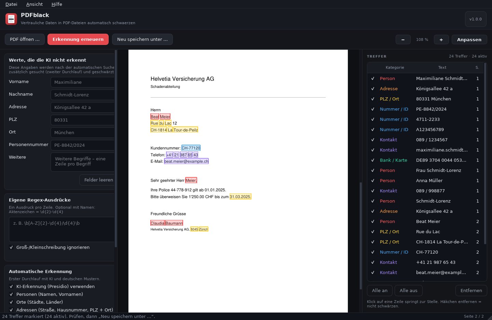

# PDFblack 1.0.1

Vertrauliche Daten in PDF-Dateien automatisch schwärzen – mit Vorschau, Prüfung
und echter Entfernung des Textes.


## Was PDFblack macht

1. PDF laden (per Drag & Drop oder über „PDF öffnen …“).
2. **Vorschau erzeugen**: Namen, Adressen, PLZ/Ort, Nummern, Kontaktdaten und
   eigene Suchmuster werden gesucht und **nur farbig markiert**. Die Datei wird
   dabei nicht verändert.
3. Prüfen und überarbeiten: Markierungen per Klick abwählen, eigene Bereiche
   aufziehen, Werte in den Feldern ergänzen und erneut suchen.
4. **Neu speichern unter …**: Alle aktiven Markierungen werden geschwärzt und
   in eine neue Datei geschrieben. Der Text unter den Flächen wird dabei
   **physisch aus dem PDF entfernt** – es wird kein schwarzes Rechteck
   darübergelegt.

## Erkennung

| Quelle | Was erkannt wird |
| --- | --- |
| KI (Microsoft Presidio + spaCy, deutsches Modell) | Personen, Vornamen, Orte, Datumsangaben |
| Muster (deutsche Regeln) | Straße + Hausnummer, PLZ + Ort, Personalnummer, Ausweis-, Versicherten-, Kunden-, Vertrags-, Aktenzeichen u. a. |
| Muster (Schweizer Regeln) | vierstellige PLZ: `CH-8045`, `CH 3000`, `8045 Zürich`, `CH-1814 La Tour-de-Peilz` |
| Kontakt/Bank | E-Mail, Telefon (auch `+41 …`), IBAN |
| Zweiter Durchlauf | alle Werte aus den Eingabefeldern (Vorname, Nachname, Adresse, PLZ, Ort, Personennummer, weitere Begriffe) |
| Eigene Regexe | beliebige reguläre Ausdrücke, ein Ausdruck pro Zeile |

Schweizer Postleitzahlen sind nur vierstellig. Damit nicht jede vierstellige
Zahl (Jahr, Betrag, Stückzahl) geschwärzt wird, verlangt die Erkennung entweder
den Präfix `CH`/`CH-` oder einen Ortsnamen dahinter, der kein Betrag und keine
Mengenangabe ist („1500 Franken“ bleibt also stehen). Der Ort darf auch in der
nächsten Zeile stehen (`9435` / `Heerbrugg`) und kleingeschrieben sein;
Füllwörter wie „und“, „bis“ oder „Personen“ machen eine Zahl nicht zur PLZ. Abschalten lässt sich das
über „Automatische Erkennung → Schweizer PLZ“.



Der zweite Durchlauf greift genau dann, wenn die KI etwas nicht erkannt hat:
Werte in die Felder eintragen, „Erkennung erneuern“ drücken, fertig.

Ein einmal erkannter oder eingegebener Name wird im **ganzen Dokument** gesucht
und geschwärzt – auch dann, wenn er mitten in einer Adresszeile, im Briefkopf
oder in einer Fußzeile steht („Zustellung an: Schmidt-Lorenz, Königsallee 42 a“).
Bei sehr häufigen Nachnamen kann das zu viel des Guten sein: solche Treffer
lassen sich in der Vorschau einzeln abwählen.

### Eigene Regex-Ausdrücke

Ein Muster pro Zeile. Optional mit Namen, der in der Trefferliste erscheint:

```
\d{2}-\d{4}/\d{2}
Aktenzeichen = [A-Z]{2}-\d{4,6}
```

Ungültige Ausdrücke werden sofort rot gemeldet, bevor die Suche startet.

## Installation aus dem Quellcode

Voraussetzung: Python 3.10+ (getestet mit 3.12).

```bash
python3 -m venv .venv
source .venv/bin/activate            # Windows: .venv\Scripts\activate
pip install -r requirements.txt
python -m spacy download de_core_news_md
pip install -e .

pdfblack                             # startet die Anwendung
pdfblack samples/beispiel.pdf        # optional direkt mit Datei
```

Ohne das deutsche spaCy-Modell läuft PDFblack weiter, verwendet dann aber nur
Muster, manuelle Werte und Regexe – die Oberfläche weist darauf hin.

## Bedienung im Detail

- **Markierung anklicken**: schaltet den Treffer aus oder wieder ein (gestrichelt
  = wird nicht geschwärzt).
- **Mit der Maus aufziehen**: fügt einen eigenen Schwärzungsbereich hinzu.
- **Trefferliste rechts**: Häkchen entfernen, Zeile anklicken (springt zur
  Stelle), „Entfernen“ löscht markierte Einträge.
- **Zoom**: `+`/`−`, `Strg + Mausrad`, „Anpassen“ passt die Seitenbreite ein.
- **Tastenkürzel**: `Strg+O` öffnen, `Strg+S` speichern unter, `F1` Anleitung.
- **Gemerkte Einstellungen**: Die Häkchen unter „Automatische Erkennung“ und die
  Empfindlichkeit gelten auch beim nächsten Start. Die Felder für eigene Werte
  bleiben bewusst leer – sie gehören zur jeweiligen Datei.

## Updates

PDFblack prüft beim Start im Hintergrund, ob auf
[github.com/soendi/PDFblack/releases](https://github.com/soendi/PDFblack/releases)
eine neuere Version steht, lädt sie und spielt sie ein – ohne Assistent und
ohne Rückfrage. Von Hand geht das über **Hilfe → Nach Updates suchen …**; dort
meldet die Anwendung auch, wenn die installierte Version die aktuelle ist.

Das Update ist für die Windows-Fassung gedacht: Das Setup-Programm läuft
still, PDFblack wird geschlossen, ersetzt und neu gestartet. Windows kann dabei
einmal die Sicherheitsabfrage (UAC) zeigen. Eine Quellcode-Installation wird
nicht angetastet – sie bekommt nur den Hinweis auf die neue Version.

Abschalten: `pdfblack --no-update` oder die Umgebungsvariable
`PDFBLACK_NO_UPDATE=1`. Ein anderes Repository lässt sich mit
`PDFBLACK_UPDATE_REPO=besitzer/name` einstellen.

## Grenzen

- PDFs ohne Textebene (reine Scans) enthalten keinen durchsuchbaren Text und
  können nicht automatisch geschwärzt werden. Hier hilft nur das manuelle
  Aufziehen von Bereichen.
- Handschrift und Text in Bildern wird nicht erkannt.
- Namens- und Ortserkennung ist statistisch: Es können Treffer fehlen oder
  überflüssige entstehen. Deshalb ist die Vorschau vor dem Speichern Pflicht –
  bitte jede Datei vor der Weitergabe prüfen.
- Beim Speichern werden Textstellen entfernt, Links auf geschwärzte Stellen
  gelöscht und die Datei neu geschrieben. Eingebettete Bilder bleiben
  unverändert.

## Installer bauen

Alle Varianten setzen eine virtuelle Umgebung mit den Abhängigkeiten voraus.

**Windows (Setup-EXE)**

```powershell
powershell -ExecutionPolicy Bypass -File packaging\build_windows.ps1
# Ergebnis: dist\PDFblack-1.0.1-Setup.exe  (benötigt Inno Setup 6)
```

**macOS (.app + ZIP)**

```bash
bash packaging/build_macos.sh
```

Jeder Build führt anschließend `PDFblack --self-test` aus: Der Test prüft
Presidio, die Mustererkennung und die Schwärzung ohne Oberfläche und bricht bei
einem Fehler ab.

## Entwicklung

```bash
pip install pytest
pytest                                   # Kern-Tests (Erkennung + Schwärzung)
python tools/make_sample.py              # Beispiel-PDF neu erzeugen
python tools/ui_preview.py               # Screenshots ohne Bildschirm
```

Aufbau:

```
src/pdfblack/
  core/extract.py   Text + Wortkoordinaten aus dem PDF
  core/rules.py     deutsche Muster (Adresse, PLZ, IDs, Kontakt)
  core/detect.py    Pipeline: Presidio, Muster, manuelle Werte, Regex
  core/redact.py    physisches Schwärzen und Neuschreiben der Datei
  ui/               Oberfläche (Qt), Canvas mit Markierungen, Panels
tools/              Beispiel-PDF und Headless-Vorschau
packaging/          PyInstaller, Inno Setup (Windows), macOS
tests/              Tests für Erkennung und Schwärzung
```

## Lizenzen

Eigener Code: MIT. Verwendete Bibliotheken:

- **Microsoft Presidio** – MIT-Lizenz, darf auch kommerziell eingebettet werden.
- **spaCy** und Modell `de_core_news_md` – MIT-Lizenz.
- **PyMuPDF** – AGPL-3.0 oder kommerzielle Lizenz des Anbieters Artifex. Für
  eine kommerzielle Weitergabe ohne Quelloffenlegung ist eine PyMuPDF-Lizenz
  erforderlich.
- **PySide6 / Qt** – LGPL-3.0.
