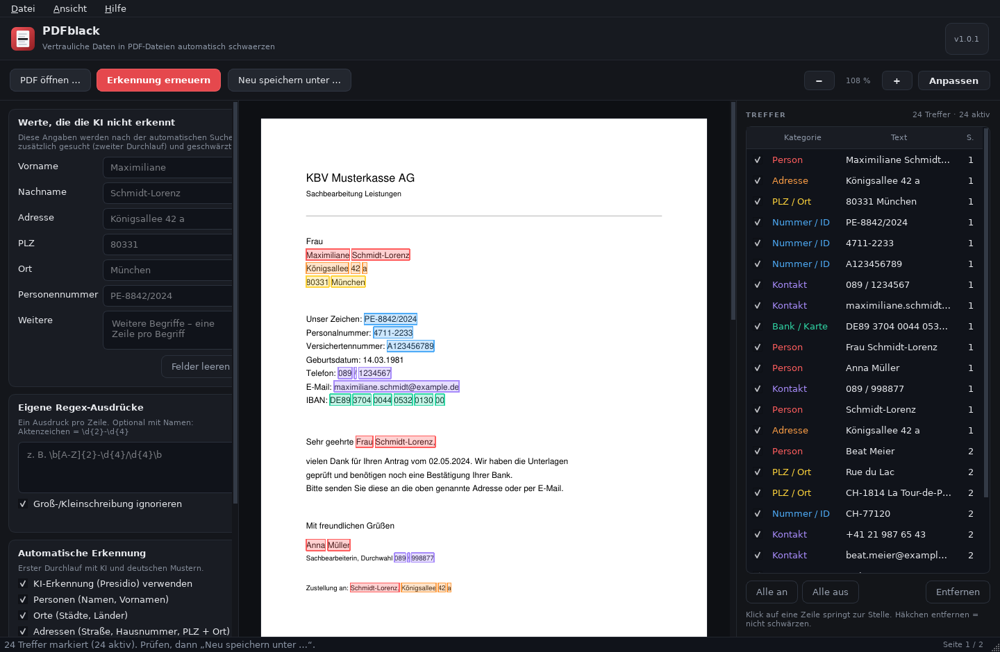

# PDFblack 1.3.15

Vertrauliche Daten in PDF-Dateien automatisch schwärzen – mit Vorschau, Prüfung
und echter Entfernung des Textes.



## Was PDFblack macht

1. PDF laden (per Drag & Drop oder über „PDF öffnen …“).
2. Die Prüfung startet **automatisch**: Namen, Adressen, PLZ/Ort, Nummern,
   Kontaktdaten und eigene Suchmuster werden gesucht und **nur farbig
   markiert**. Die Datei wird dabei nicht verändert. Mit „Vorschau erzeugen“
   lässt sich die Prüfung jederzeit erneut anstoßen.
3. Prüfen und überarbeiten: Markierungen per Klick abwählen, eigene Bereiche
   aufziehen, Werte in den Feldern ergänzen und erneut suchen.
4. **Geschwärzte Kopie speichern**: Alle aktiven Markierungen werden geschwärzt
   und in eine Kopie geschrieben, die im Benutzerordner landet
   (`C:\Users\<Name>\PDFblack\Geschwärt`, unter Linux/macOS entsprechend
   `~/PDFblack/Geschwärzt`). Der Text unter den Flächen wird dabei
   **physisch aus dem PDF entfernt** – es wird kein schwarzes Rechteck
   darübergelegt. Beim Beenden von PDFblack wird der Ordner wieder geleert; die
   Kopie vorher weitergeben, wenn sie bleiben soll.

## Erkennung

| Quelle | Was erkannt wird |
| --- | --- |
| KI (Microsoft Presidio + spaCy, deutsches Modell) | Personen, Vornamen, Orte, Datumsangaben |
| Muster (deutsche Regeln) | Straße + Hausnummer, PLZ + Ort, Personalnummer, Ausweis-, Versicherten-, Kunden-, Vertrags-, Aktenzeichen u. a. |
| Muster (Schweizer Regeln) | vierstellige PLZ samt Ort, geprüft gegen die amtliche Liste aller Schweizer PLZ: `CH-8045`, `CH 3000`, `8045 Zürich`, `CH-1814 La Tour-de-Peilz` |
| Kontakt/Bank | E-Mail, Telefon (auch `+41 …`), IBAN |
| Berufe | rund 11 500 Berufsbezeichnungen in männlicher und weiblicher Form, samt Steigerungen wie „Dachdeckermeister“, „Dachdeckermeisterin“ – sie werden nicht geschwärzt („Dachdecker“, „Vorarbeiterin“) |
| Firmen | Name unter einer allein stehenden Jahreszahl (`2026` / `Muster AG`) – Kategorie „Firma“ |
| Zweiter Durchlauf | alle Werte aus den Eingabefeldern (Vorname, Nachname, Adresse, PLZ, Ort, Personennummer, weitere Begriffe) |
| Eigene Regexe | beliebige reguläre Ausdrücke, ein Ausdruck pro Zeile |

Werte aus Formularfeldern (AcroForm) werden mitgelesen und beim Schwärzen
geleert und entfernt – der Wert bleibt also nicht als Feld im PDF zurück,
obwohl die Fläche geschwärzt aussieht.

Schweizer Postleitzahlen sind nur vierstellig. Damit nicht jede vierstellige
Zahl (Jahr, Betrag, Stückzahl) geschwärzt wird, prüft PDFblack jede Zahl gegen
die **amtliche Liste aller Schweizer Postleitzahlen und Ortschaften** – rund
3 400 PLZ mit ihren Ortschaften, inklusive Fürstentum Liechtenstein, mit Stand
in `src/pdfblack/data/plz_ch.json`. Was es als PLZ nicht gibt, bleibt stehen:
„1500 Franken“, „4711“ oder eine Jahreszahl wie „2026“.

Eine **Jahreszahl** liegt immer zwischen dem aktuellen Jahr und dem aktuellen
Jahr minus 70 (2026 also 1956–2026); ausserhalb dieses Bandes gibt es keine
Jahreszahlen, dort ist eine vierstellige Zahl eine Postleitzahl. Im Band muss
zusätzlich der Ort zur PLZ passen – „2000 Neuchâtel“ ist eine Adresse,
„2026 Muster AG“ nicht. Ausserhalb des Bandes bleibt die Zahl eine PLZ, deshalb
sind „1950 Sion“ und „1950 Sitten“ Adressen.
Neben `CH`/`CH-` vor der Zahl genügt ein Ortsname dahinter, der kein Betrag
und keine Mengenangabe ist; Füllwörter wie „und“, „bis“ oder „Personen“
machen eine Zahl nicht zur PLZ. Die Liste wird monatlich von swisstopo
nachgeführt und mit `python tools/build_plz_data.py` neu erzeugt. Abschalten
lässt sich das über „Automatische Erkennung → Schweizer PLZ“.

Dieselbe Liste entscheidet auch bei der **KI-Erkennung**, was ein Ort ist:
meldet das Sprachmodell ein Wort als Ort, muss der Name in der
Ortschaftenliste stehen. „Fachmessen“ oder „Dachdeckermeister“ sind keine
Ortsnamen und erscheinen deshalb nicht mehr unter „PLZ / Ort“. Treffer mit
Zahlen (PLZ, Hausnummer) prüfen weiterhin die Regeln.

**PLZ und Ort stehen in einer Zeile.** Steht eine vierstellige Zahl allein und
der Name erst in der Zeile darunter (`2026` / `Muster AG`, `9435` /
`Muster AG`), gilt der Name als **Firmenname** – er erscheint in der
Trefferliste als „Firma“ und wird geschwärzt. Überschriften und Berufe darunter
(„Berufserfahrung“, „Dachdecker“) bleiben stehen. Zwei Zeilen gelten nur dann
als Adresse, wenn der Ort wirklich zu dieser PLZ gehört (`9435` /
`Heerbrugg`, so wie in getrennten Formularfeldern) – `9435` / `Muster AG`
nicht.


## PDFocr: Bildscans auslesen

Wird in PDFblack eine Datei geöffnet, die **keinen Text** enthält (ein reiner
Bildscan), wechselt das Programm automatisch zu **PDFocr** und liest den Scan
aus. Dort lässt sich jede PDF-Datei auch von Hand öffnen; die Erkennung läuft
im Hintergrund und zeigt den Text gleich darunter an.

### Der unsichtbare Textlayer

Der erkannte Text wird **unsichtbar hinter das Bild** gelegt (Render-Modus 3,
unter dem Seiteninhalt) und zwar genau in das Rechteck, in dem das Wort im Bild
steht: Die Seite wird mit 300 dpi gerendert, Tesseracts Wortkästen werden mit
demselben Faktor in PDF-Punkte zurückgerechnet, und jedes Wort wird waagerecht
auf seine Kastenbreite gestaucht. Dadurch sitzt der Text deckungsgleich über
dem Scan – eine spätere Schwärzung trifft dieselbe Stelle im Bild und ersetzt
auch die Bildpunkte im Schwärzungsbereich.

### Wörterbuch-Korrektur

Vor dem Einsetzen prüft PDFocr die erkannten Wörter gegen ein deutsches
Wörterbuch (rund 339 000 Wörter, Bibliothek `pyspellchecker`, MIT-Lizenz) und
ersetzt offensichtliche Lesefehler – „bewerbng“ wird „bewerbung“,
„dachdeker“ wird „dachdecker“. Damit die Schwärzung nicht darunter leidet, ist
die Korrektur bewusst vorsichtig:

- nur **klein geschriebene** Einzelwörter – Namen, Straßen und Firmen sind im
  Deutschen groß geschrieben und bleiben unverändert,
- nur Wörter, die im Dokument **einmal** vorkommen (ein wiederholtes Wort ist
  eher ein Eigenname als ein Tippfehler),
- nur wenn es **genau einen** nahen Vorschlag gibt und das Wort lang genug ist
  (ab fünf Buchstaben, keine Ziffern, keine Bindestriche).

Abschalten lässt sich das über das Häkchen „Rechtschreibung prüfen
(Wörterbuch)“ auf der Seite.

### Ablauf

1. Datei öffnen – bei einem reinen Bildscan passiert das automatisch, sonst
   über „PDF öffnen …“ oder per Ziehen ins Fenster.
2. Sprache wählen (Deutsch, Englisch, Französisch, Italienisch,
   Deutsch+Englisch) und „Text erkennen“ drücken.
3. Der erkannte Text erscheint darunter; „Textlayer speichern unter …“ schreibt
   die neue PDF-Datei.
4. „In PDFblack öffnen“ lädt sie zum Prüfen und Schwärzen.

Seiten, die bereits Text enthalten, bleiben unverändert und werden nicht
neu erkannt.

### Alles lokal

Rendern (PyMuPDF), Erkennung (Tesseract im Programm) und Wörterbuch-Korrektur
laufen ausschließlich auf dem Rechner – es werden keine Bild- oder Textdaten
übertragen, und die Funktion arbeitet auch offline. Die neue Datei liegt bis
zum Speichern in einem temporären Ordner.

### Keine Installation nötig

Tesseract und Leptonica stecken als Bibliotheken im Programm (`tesserocr`),
die Sprachdateien liegen in `src/pdfblack/data/tessdata` (Quelle
`tessdata_fast`, Apache-2.0). Die Erkennung läuft im eigenen Prozess: **keine
separate Tesseract-Installation, keine Adminrechte, kein Download, keine
Prüfung beim Start.** Mitgeliefert sind Deutsch, Englisch, Französisch und
Italienisch – genau die Sprachen der Auswahlliste; eine
Ausrichtungserkennung (`osd`) braucht PDFblack nicht.

**Berufsbezeichnungen** stehen in einer eigenen Liste
(`src/pdfblack/data/berufe.json`, rund 11 500 Einträge in männlicher und
weiblicher Form, Quelle Wikidata (CC0) plus gängige Berufe). Sie gelten weder
als Name noch als Adresse: „Vorarbeiterin von 10 Dachdecker“ ergibt keinen
Treffer, und eine erkannte Person wird nur über ihre Namensbestandteile im
Dokument gesucht, nicht über den Beruf. Zusammensetzungen aus Beruf und
Zusatz gelten ebenfalls als Beruf – „Dachdeckermeister“, „Dachdeckermeisterin“,
„Dachdeckergeselle“, „Dachdeckerlehrling“, „Maurermeister“ –, ein Name mit
solchem Zusatz („Mustermeister“) aber nicht. Nachnamen, die zugleich Berufe sind
(„Herr Müller“, „Frau Koch“), zählen weiter als Namen. Neu bauen:
`python tools/build_berufe_data.py`.

Bei Adressen muss die Hausnummer das Wort beenden: Folgt nach der Nummer noch
ein ganzes Wort („Vorarbeiterin von 10 Dachdecker“, „Hauptstraße 12 Telefon“),
ist es keine Adresse. Verbindungen wie „in 8000 Zürich“ sind erlaubt, damit
Adressen mitten im Satz gefunden werden.

Der zweite Durchlauf greift genau dann, wenn die KI etwas nicht erkannt hat:
Werte in die Felder eintragen, „Erkennung erneuern“ drücken, fertig.

Ein einmal erkannter oder eingegebener Name wird im **ganzen Dokument** gesucht
und geschwärzt – auch dann, wenn er mitten in einer Adresszeile, im Briefkopf
oder in einer Fußzeile steht („Zustellung an: Schmidt-Lorenz, Königsallee 42 a“).
Bei sehr häufigen Nachnamen kann das zu viel des Guten sein: solche Treffer
lassen sich in der Vorschau einzeln abwählen.

### Eigene Regex-Ausdrücke

Ein Muster pro Zeile. Optional mit Namen, der in der Trefferliste erscheint:

```
\d{2}-\d{4}/\d{2}
Aktenzeichen = [A-Z]{2}-\d{4,6}
```

`^` und `$` passen auf **Zeilenanfang und Zeilenende** – `^\d{12}$` findet
also eine zwölfstellige Nummer, die allein in ihrer Zeile steht. Steht die
Nummer in einer Zeile mit anderem Text („Lizenznummer: 558416824044“), nimmt
man Wortgrenzen: `\b\d{12}\b`.

Ungültige Ausdrücke werden sofort rot gemeldet, bevor die Suche startet.

## Installation aus dem Quellcode

Voraussetzung: Python 3.10+ (getestet mit 3.12).

```bash
python3 -m venv .venv
source .venv/bin/activate            # Windows: .venv\Scripts\activate
pip install -r requirements.txt
python -m spacy download de_core_news_md
pip install -e .

pdfblack                             # startet die Anwendung
pdfblack samples/beispiel.pdf        # optional direkt mit Datei
```

Ohne das deutsche spaCy-Modell läuft PDFblack weiter, verwendet dann aber nur
Muster, manuelle Werte und Regexe – die Oberfläche weist darauf hin.

## Bedienung im Detail

- **Markierung anklicken**: schaltet den Treffer aus oder wieder ein (gestrichelt
  = wird nicht geschwärzt).
- **Mit der Maus aufziehen**: fügt einen eigenen Schwärzungsbereich hinzu.
- **PDFcompare** (Logo rechts in der Kopfzeile): links die zuletzt geschwärzten
  Dateien, rechts die zwei Stapel „Lebenslauf“ und „Arbeitszeugnisse“. Dateien
  per Ziehen aus der linken Liste zuordnen, mit `Entf` wieder entfernen.
- **Datei → Einstellungen …** (`Strg+,`): PDFcompare mit Windows Copilot
  verknüpfen und den Agenten auswählen.
- **Doppelklick ins PDF**: das Wort unter dem Cursor wird sofort als eigene
  Schwärzung übernommen (Kategorie „Manuell“) – wie ein darum gezogener Rahmen.
- **Trefferliste rechts**: Häkchen entfernen, Zeile anklicken (springt zur
  Stelle), „Entfernen“ löscht markierte Einträge.
- **Nach Kategorie**: der zweite Abschnitt der Trefferspalte gruppiert alles
  nach Art (Personen, Adressen, PLZ/Ort …). Ein Häkchen vor der Überschrift
  schaltet die ganze Gruppe ein oder aus, ein Häkchen vor einem Eintrag nur
  diesen.
- **Zoom**: `+`/`−`, `Strg + Mausrad`, „Anpassen“ passt die Seitenbreite ein.
- **Tastenkürzel**: `Strg+O` öffnen, `Strg+S` geschwärzte Kopie speichern, `F1` Anleitung.
- **Gemerkte Einstellungen**: Die Häkchen unter „Automatische Erkennung“ und die
  Empfindlichkeit gelten auch beim nächsten Start. Die Felder für eigene Werte
  bleiben bewusst leer – sie gehören zur jeweiligen Datei.

## Updates

PDFblack prüft beim Start im Hintergrund, ob auf
[github.com/soendi/PDFblack/releases](https://github.com/soendi/PDFblack/releases)
eine neuere Version steht, lädt sie und spielt sie ein – ohne Assistent und
ohne Rückfrage. Von Hand geht das über **Hilfe → Nach Updates suchen …**; dort
meldet die Anwendung auch, wenn die installierte Version die aktuelle ist.

Das Update ist für die Windows-Fassung gedacht: Das Setup-Programm läuft
still, PDFblack wird geschlossen und ersetzt; sobald die Installation durch
ist, startet sich das Programm von selbst wieder. Während des
Ladens zeigt die Statuszeile einen Ladebalken mit Prozentangabe. Windows kann
dabei einmal die Sicherheitsabfrage (UAC) zeigen. Eine Quellcode-Installation wird
nicht angetastet – sie bekommt nur den Hinweis auf die neue Version.

Abschalten: `pdfblack --no-update` oder die Umgebungsvariable
`PDFBLACK_NO_UPDATE=1`. Ein anderes Repository lässt sich mit
`PDFBLACK_UPDATE_REPO=besitzer/name` einstellen.

## Grenzen

- PDFs ohne Textebene (reine Scans) enthalten keinen durchsuchbaren Text und
  können nicht automatisch geschwärzt werden. Hier hilft nur das manuelle
  Aufziehen von Bereichen.
- Handschrift und Text in Bildern wird nicht erkannt.
- Namens- und Ortserkennung ist statistisch: Es können Treffer fehlen oder
  überflüssige entstehen. Deshalb ist die Vorschau vor dem Speichern Pflicht –
  bitte jede Datei vor der Weitergabe prüfen.
- Beim Speichern werden Textstellen entfernt, Links auf geschwärzte Stellen
  gelöscht und die Datei neu geschrieben. Eingebettete Bilder bleiben
  unverändert.

## Installer bauen

Alle Varianten setzen eine virtuelle Umgebung mit den Abhängigkeiten voraus.

**Windows (Setup-EXE)**

```powershell
powershell -ExecutionPolicy Bypass -File packaging\build_windows.ps1
# Ergebnis: dist\PDFblack-1.3.15-Setup.exe  (benötigt Inno Setup 6)
```

**macOS (.app + ZIP)**

```bash
bash packaging/build_macos.sh
```

Jeder Build führt anschließend `PDFblack --self-test` aus: Der Test prüft
Presidio, die Mustererkennung und die Schwärzung ohne Oberfläche und bricht bei
einem Fehler ab.

## Entwicklung

```bash
pip install pytest
pytest                                   # Kern-Tests (Erkennung + Schwärzung)
python tools/make_sample.py              # Beispiel-PDF neu erzeugen
python tools/ui_preview.py               # Screenshots ohne Bildschirm
```

Aufbau:

```
src/pdfblack/
  core/extract.py   Text + Wortkoordinaten aus dem PDF
  core/rules.py     deutsche Muster (Adresse, PLZ, IDs, Kontakt)
  core/detect.py    Pipeline: Presidio, Muster, manuelle Werte, Regex
  core/redact.py    physisches Schwärzen und Neuschreiben der Datei
  ui/               Oberfläche (Qt), Canvas mit Markierungen, Panels
tools/              Beispiel-PDF und Headless-Vorschau
packaging/          PyInstaller, Inno Setup (Windows), macOS
tests/              Tests für Erkennung und Schwärzung
```

## Lizenzen

Eigener Code: MIT. Verwendete Bibliotheken:

- **Microsoft Presidio** – MIT-Lizenz, darf auch kommerziell eingebettet werden.
- **spaCy** und Modell `de_core_news_md` – MIT-Lizenz.
- **PyMuPDF** – AGPL-3.0 oder kommerzielle Lizenz des Anbieters Artifex. Für
  eine kommerzielle Weitergabe ohne Quelloffenlegung ist eine PyMuPDF-Lizenz
  erforderlich.
- **PySide6 / Qt** – LGPL-3.0.
- **Berufsbezeichnungen** (`src/pdfblack/data/berufe.json`) – Wikidata, CC0
  (gemeinfrei); ergänzt um eine eigene Liste gängiger Berufe.
- **Tesseract und Leptonica** (`tesserocr`) – Apache-2.0 bzw. BSD-2-Clause.
- **Sprachmodelle** (`src/pdfblack/data/tessdata/*.traineddata`, deutsch,
  englisch, französisch, italienisch) – `tessdata_fast` aus dem
  Tesseract-Projekt, Apache-2.0.
- **PLZ- und Ortschaftsliste** (`src/pdfblack/data/plz_ch.json`) – amtliches
  Ortschaftenverzeichnis mit Postleitzahl von swisstopo/swisstopo.admin.ch
  (opendata.swiss, freie Nutzung, Quellenangabe erforderlich) sowie
  Postleitzahldaten von GeoNames (CC BY 4.0). Neu bauen:
  `python tools/build_plz_data.py`.
